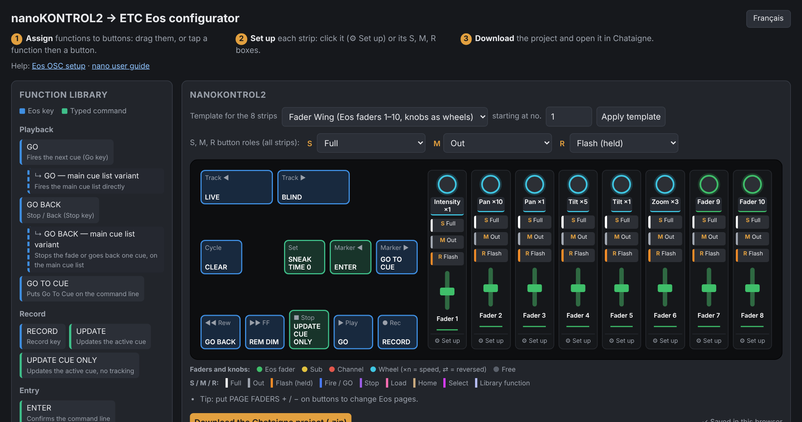

# Eos × Chataigne — controllers

🇫🇷 [Version française](README.md)

Control **ETC Eos / ETCnomad** with affordable USB controllers, through [Chataigne](https://github.com/benkuper/Chataigne) and OSC. Ready-to-use projects and an online configurator, no coding.

| Controller | Folder | Features |
|---|---|---|
| Korg **nanoKONTROL2** | [`nanokontrol2/`](nanokontrol2/README.en.md) | Fader wing (10 faders), S / M / R, GO / Back, Live / Blind, Sneak, Record, knobs as pan / tilt / zoom / intensity wheels. **[Configurator](https://100ders.github.io/eos-chataigne-controllers/?lang=en)** |
| Contour **ShuttleXpress** | [`shuttlexpress/`](shuttlexpress/README.en.md) | Jog and shuttle ring on intensity / pan / tilt / zoom, Home. Requires [ShuttleXpressOSC](https://github.com/100ders/shuttleXpress-OSC) |

```
Controller ──USB──▶ Chataigne ──OSC :8000──▶ Eos
```

---

## 🎛️ nanoKONTROL2 configurator

**[▶ Open the configurator](https://100ders.github.io/eos-chataigne-controllers/?lang=en)** (English or French)

[](https://100ders.github.io/eos-chataigne-controllers/?lang=en)

1. **Assign** Eos functions to buttons: drag and drop, or tap a function then a button.
2. **Set up** each strip: Eos fader, sub or channel, knob as a wheel (pan, tilt…), S / M / R button roles.
3. **Download** the project: a `.zip` ready to open in Chataigne, with the knob script, your configuration and instructions.

Works on desktop, tablet and phone, and offline (file `docs/index.html`). Details: [nano README](nanokontrol2/README.en.md#the-configurator).

---

## Getting started
1. Install Chataigne from the [download page](https://benjamin.kuperberg.fr/chataigne/en) ([source code](https://github.com/benkuper/Chataigne)). Tested with **1.9.24**.
2. In Eos, enable OSC reception on port **8000**: **[Eos OSC setup](docs/eos-osc-setup.en.md)**.
3. Get the controller's project:
   - nanoKONTROL2: the [configurator](https://100ders.github.io/eos-chataigne-controllers/?lang=en), or the ready-made project in [`nanokontrol2/`](nanokontrol2/README.en.md);
   - ShuttleXpress: the [`shuttlexpress/`](shuttlexpress/README.en.md) folder.
4. Open the `.noisette` in Chataigne and follow the controller's README.

Tested with ETCnomad in Offline mode, on Windows and macOS.

## Ports
| Flow | Port | |
|---|---|---|
| Chataigne → Eos (commands) | **8000** | Eos OSC UDP RX, required |
| Eos → Chataigne (feedback) | **9000** | Eos OSC UDP TX, optional |
| ShuttleXpressOSC → Chataigne | **9000** | ShuttleXpress only |

## Repository layout
```
docs/
  index.html                  configurator (GitHub Pages)
  eos-osc-setup.en.md         Eos OSC setup (+ French .md)
  images/
nanokontrol2/
  nanoKONTROL2-EOS.noisette   ready-made project
  encodeurs-relatifs.js       knobs as wheels
  README.en.md                (+ French README.md)
shuttlexpress/
  Shuttle-EOS.noisette
  README.en.md                (+ French README.md)
tools/
  configurateur.src.html      configurator source
  build-configurateur.py      builds docs/index.html
  templates.json              Chataigne templates
```

**Editing the configurator**: edit `tools/configurateur.src.html`, then run `python3 tools/build-configurateur.py`, which builds `docs/index.html` from the nano's `.noisette`. Don't edit `docs/index.html` directly.

---

📜 GPL v3 · Independent project, not affiliated with ETC, Korg, Contour Design or Chataigne.
