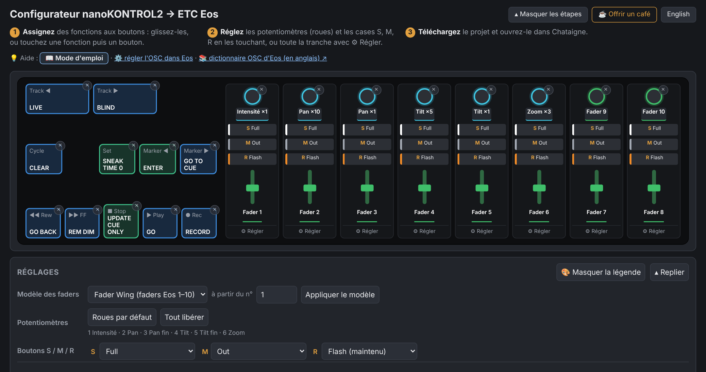

# Eos × Chataigne — contrôleurs

🇬🇧 [English version](README.en.md)

Transformer un **Korg nanoKONTROL2** en **fader wing** pour **ETC Eos / ETCnomad**, et piloter les roues avec un **Contour ShuttleXpress** : des contrôleurs MIDI et USB bon marché, reliés à Eos par [Chataigne](https://github.com/benkuper/Chataigne) et l'OSC. Projets prêts à l'emploi et configurateur en ligne, sans programmation.

| Contrôleur | Dossier | Fonctions |
|---|---|---|
| Korg **nanoKONTROL2** | [`nanokontrol2/`](nanokontrol2/README.md) | Fader wing (10 faders), S / M / R, GO / Back, Live / Blind, Sneak, Record, potentiomètres en roues pan / tilt / zoom / intensité. **[Configurateur](https://100ders.github.io/eos-chataigne-controllers/)** |
| Contour **ShuttleXpress** | [`shuttlexpress/`](shuttlexpress/README.md) | Jog et bague sur intensité / pan / tilt / zoom, Home. Nécessite [ShuttleXpressOSC](https://github.com/100ders/shuttleXpress-OSC) |

```
Contrôleur ──USB──▶ Chataigne ──OSC :8000──▶ Eos
```

---

## 🎛️ Configurateur nanoKONTROL2

**[▶ Ouvrir le configurateur](https://100ders.github.io/eos-chataigne-controllers/)** (français ou anglais)

[](https://100ders.github.io/eos-chataigne-controllers/)

1. **Assignez** des fonctions Eos aux boutons : glisser-déposer, ou toucher une fonction puis un bouton.
2. **Réglez** chaque tranche : fader Eos, sub ou circuit, potentiomètre en roue (pan, tilt…), rôle des boutons S / M / R.
3. **Téléchargez** le projet : un `.zip` prêt à ouvrir dans Chataigne, avec le script des potentiomètres, votre configuration et un mode d'emploi.

Fonctionne sur ordinateur, tablette et téléphone, et hors ligne (fichier `docs/index.html`). Détails : [README du nano](nanokontrol2/README.md#le-configurateur).

---

## Démarrage
1. Installer Chataigne depuis la [page de téléchargement](https://benjamin.kuperberg.fr/chataigne/) ([code source](https://github.com/benkuper/Chataigne)). Testé en **1.9.24**.
2. Dans Eos, activer la réception OSC sur le port **8000** : **[paramétrage OSC d'Eos](docs/eos-osc-setup.md)**.
3. Récupérer le projet du contrôleur :
   - nanoKONTROL2 : le [configurateur](https://100ders.github.io/eos-chataigne-controllers/), ou le projet prêt du dossier [`nanokontrol2/`](nanokontrol2/README.md) ;
   - ShuttleXpress : le dossier [`shuttlexpress/`](shuttlexpress/README.md).
4. Ouvrir le `.noisette` dans Chataigne et suivre le README du contrôleur.

Testé avec ETCnomad en mode Offline, sous Windows et macOS.

## Ports
| Flux | Port | |
|---|---|---|
| Chataigne → Eos (commandes) | **8000** | Eos OSC UDP RX, obligatoire |
| Eos → Chataigne (retour) | **9000** | Eos OSC UDP TX, optionnel |
| ShuttleXpressOSC → Chataigne | **9000** | ShuttleXpress uniquement |

## Contenu du dépôt
```
docs/
  index.html                  configurateur (GitHub Pages)
  eos-osc-setup.md            paramétrage OSC d'Eos (+ .en.md)
  images/
nanokontrol2/
  nanoKONTROL2-EOS.noisette   projet prêt
  encodeurs-relatifs.js       potentiomètres en roues
  README.md                   (+ README.en.md)
shuttlexpress/
  Shuttle-EOS.noisette
  README.md                   (+ README.en.md)
tools/
  configurateur.src.html      source du configurateur
  build-configurateur.py      génère docs/index.html
  templates.json              modèles Chataigne
```

**Modifier le configurateur** : éditer `tools/configurateur.src.html`, puis lancer `python3 tools/build-configurateur.py`, qui génère `docs/index.html` à partir du `.noisette` du nano. Ne pas modifier `docs/index.html` directement.

---

📜 GPL v3 · Projet indépendant, non affilié à ETC, Korg, Contour Design ni Chataigne.
