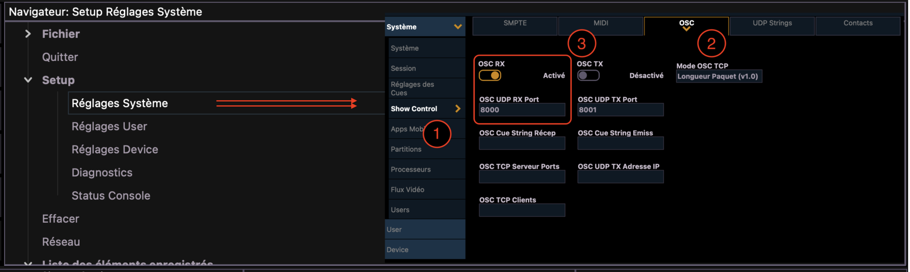
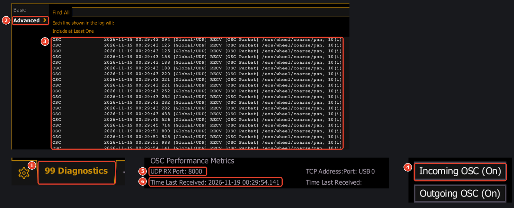

# Eos OSC setup

🇫🇷 [Version française](eos-osc-setup.md)

Shared by every controller in this repo: Eos must **receive** the OSC sent by [Chataigne](https://github.com/benkuper/Chataigne).

```
Controller ──USB──▶ Chataigne ──OSC UDP :8000──▶ Eos
                        ▲                         │
                        └──── OSC UDP :9000 ──────┘  feedback, optional
```

## Enable reception
In Eos: **Setup › System Settings**. The screenshot shows the French interface; the numbers match the steps.



1. **Show Control** (left column).
2. **OSC** tab.
3. **OSC RX: Enabled** and **OSC UDP RX Port: 8000**.

That's all the nanoKONTROL2 needs. These are *System Settings*: if they are gone after loading another show, set them again.

## All settings
| Setting | Value | Needed? |
|---|---|---|
| OSC RX | **Enabled** | ✅ Always |
| OSC UDP RX Port | **8000** | ✅ Always |
| OSC TX | Enabled | Only for feedback from Eos to Chataigne (`/eos/active/wheel/…` commands, showing Eos information). Not needed for the nanoKONTROL2 |
| OSC UDP TX Port | **9000** | If OSC TX is enabled |
| OSC UDP TX IP Address | `127.0.0.1` (same computer) or the Chataigne computer's IP | If OSC TX is enabled |

In the screenshot OSC TX is disabled, so the TX port shown (8001) is not used.

## In Chataigne
**OSC** module › **OSC Outputs › OSC Output**:
- **Remote Host**: `127.0.0.1` if Eos runs on the same computer, otherwise the console's IP (untick **Local**);
- **Remote port**: **8000**.

The projects in this repo are already set this way. Details with screenshot: [nanoKONTROL2 OSC module](../nanokontrol2/README.en.md#osc-module).

## Check that it works
First in Chataigne: tick **Log Outgoing** on the OSC module, then open the **Logger**. Every controller move should show an `/eos/…` message.

Then in Eos:



1. Type **`Tab 99`**: **Diagnostics** tab.
2. Switch to the **Advanced** view: the detailed log.
3. Every message received from Chataigne shows as `RECV [OSC Packet] /eos/…`, with any errors (e.g. `missing argument`).
4. **Incoming OSC (On)**: turn it on to see the RECV lines.
5. **UDP RX Port**: Eos's receive port (8000).
6. **Time Last Received**: when the last message arrived.

## Troubleshooting
| Symptom | Likely cause | Fix |
|---|---|---|
| Nothing in `Tab 99` | Log turned off, OSC RX disabled, wrong port or firewall | Turn on **Incoming OSC (On)**. Check RX = 8000 on both sides. On Windows, allow Eos and Chataigne through the firewall |
| Buttons work, faders don't | OSC fader bank not created | In Chataigne, **INITIALISATION** State: click **Trigger** |
| Pan, tilt or zoom don't move | No fixture selected | Wheels act on the **selected channels** in Eos |
| `invalid active parameter` | `/eos/active/wheel/…` command without OSC TX | Enable OSC TX (port 9000) or use `/eos/wheel/…` |
| Console on another computer | `127.0.0.1` address | Put the console's IP in Chataigne, and Chataigne's IP in OSC UDP TX if TX is used |

Also works with **ETCnomad in Offline mode** (tested on Windows and macOS).
