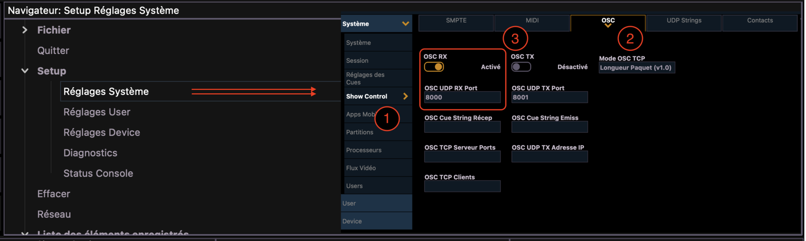
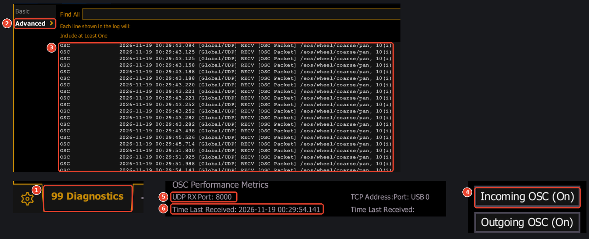

# Paramétrage OSC d'Eos

🇬🇧 [English version](eos-osc-setup.en.md)

Réglage commun à tous les contrôleurs du dépôt : Eos doit **recevoir** l'OSC envoyé par [Chataigne](https://github.com/benkuper/Chataigne).

```
Contrôleur ──USB──▶ Chataigne ──OSC UDP :8000──▶ Eos
                        ▲                         │
                        └──── OSC UDP :9000 ──────┘  retour, optionnel
```

## Activer la réception
Dans Eos : **Setup › Réglages Système**.



1. **Show Control** (colonne de gauche).
2. Onglet **OSC**.
3. **OSC RX : Activé** et **OSC UDP RX Port : 8000**.

C'est tout pour le nanoKONTROL2. Ces réglages font partie des *Réglages Système* : s'ils disparaissent après le chargement d'un autre show, refaites-les.

## Tous les réglages
| Réglage | Valeur | Nécessaire ? |
|---|---|---|
| OSC RX | **Activé** | ✅ Toujours |
| OSC UDP RX Port | **8000** | ✅ Toujours |
| OSC TX | Activé | Seulement pour le retour d'Eos vers Chataigne (commandes `/eos/active/wheel/…`, affichage d'informations Eos). Inutile pour le nanoKONTROL2 |
| OSC UDP TX Port | **9000** | Si OSC TX est activé |
| OSC UDP TX Adresse IP | `127.0.0.1` (même ordinateur) ou l'IP de l'ordinateur Chataigne | Si OSC TX est activé |

Sur la capture, OSC TX est désactivé : le port TX affiché (8001) n'est alors pas utilisé.

## Côté Chataigne
Module **OSC › OSC Outputs › OSC Output** :
- **Remote Host** : `127.0.0.1` si Eos tourne sur le même ordinateur, sinon l'IP de la console (décocher **Local**) ;
- **Remote port** : **8000**.

Les projets du dépôt sont déjà réglés ainsi. Détail avec capture : [module OSC du nanoKONTROL2](../nanokontrol2/README.md#module-osc).

## Vérifier que ça marche
D'abord dans Chataigne : cocher **Log Outgoing** sur le module OSC, puis ouvrir le **Logger**. Chaque mouvement du contrôleur doit afficher un message `/eos/…`.

Ensuite dans Eos :



1. Taper **`Tab 99`** : onglet **Diagnostics**.
2. Passer en vue **Advanced** : le journal détaillé.
3. Chaque message reçu de Chataigne s'affiche en `RECV [OSC Packet] /eos/…`, avec les éventuelles erreurs (ex. `missing argument`).
4. **Incoming OSC (On)** : à activer pour voir les lignes RECV.
5. **UDP RX Port** : le port de réception d'Eos (8000).
6. **Time Last Received** : heure du dernier message reçu.

## Dépannage
| Symptôme | Cause probable | Solution |
|---|---|---|
| Rien n'arrive dans `Tab 99` | Journal désactivé, OSC RX désactivé, mauvais port ou pare-feu | Activer **Incoming OSC (On)**. Vérifier RX = 8000 des deux côtés. Sous Windows, autoriser Eos et Chataigne dans le pare-feu |
| Les boutons répondent, pas les faders | Banque de faders OSC non créée | Dans Chataigne, State **INITIALISATION** : cliquer **Trigger** |
| Pan, tilt ou zoom ne bougent pas | Aucun projecteur sélectionné | Les roues agissent sur les **canaux sélectionnés** dans Eos |
| `invalid active parameter` | Commande `/eos/active/wheel/…` sans OSC TX | Activer OSC TX (port 9000) ou utiliser `/eos/wheel/…` |
| Console sur un autre ordinateur | Adresse `127.0.0.1` | Mettre l'IP de la console dans Chataigne, et celle de Chataigne dans OSC UDP TX si TX est utilisé |

Fonctionne aussi avec **ETCnomad en mode Offline** (testé sous Windows et macOS).
