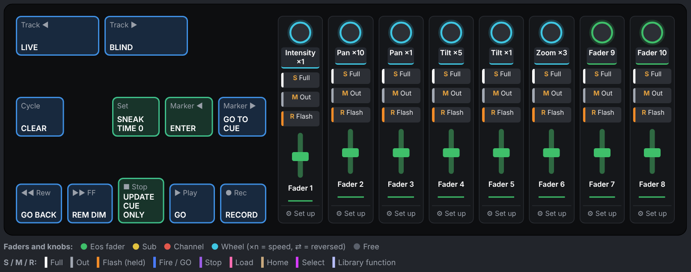
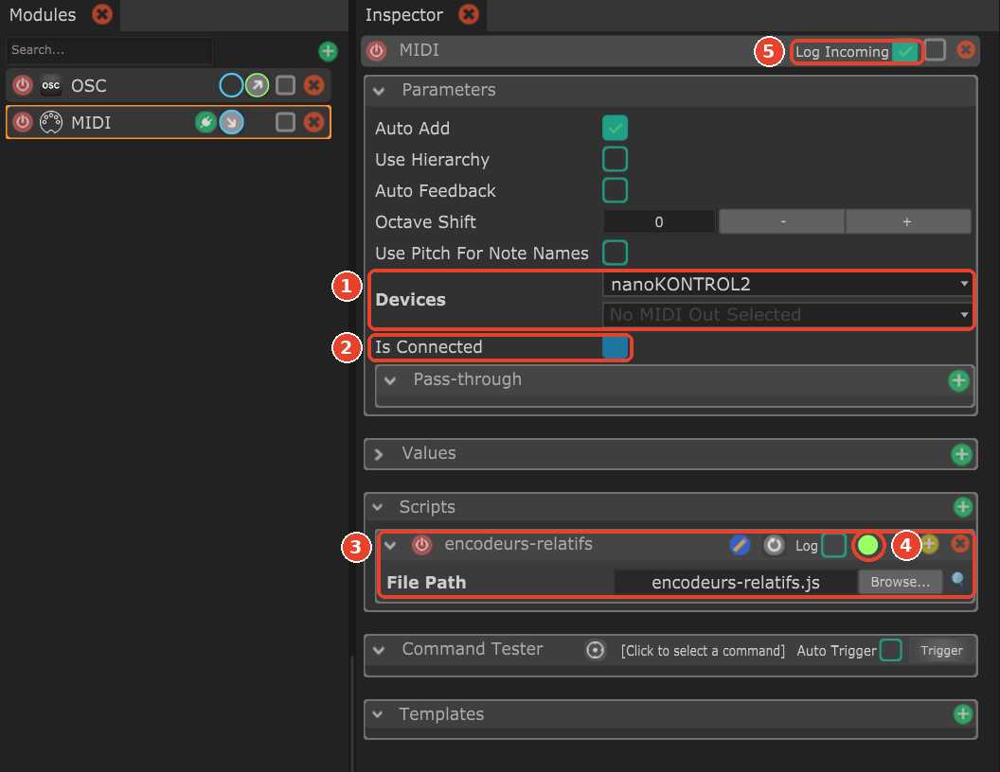
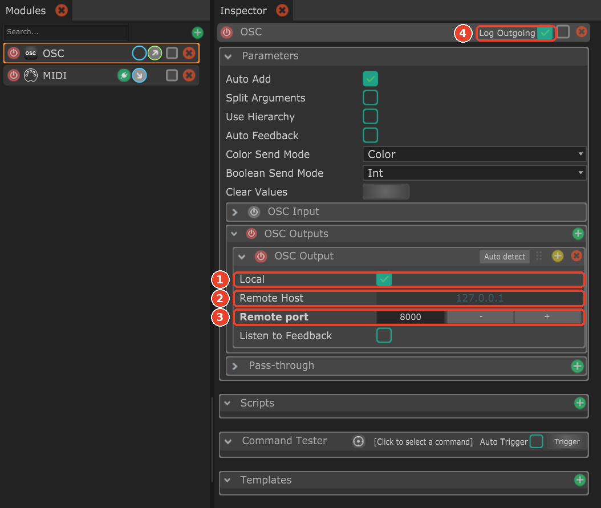
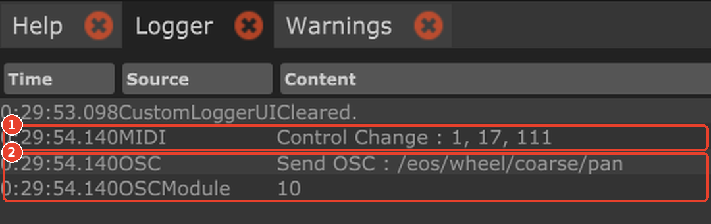
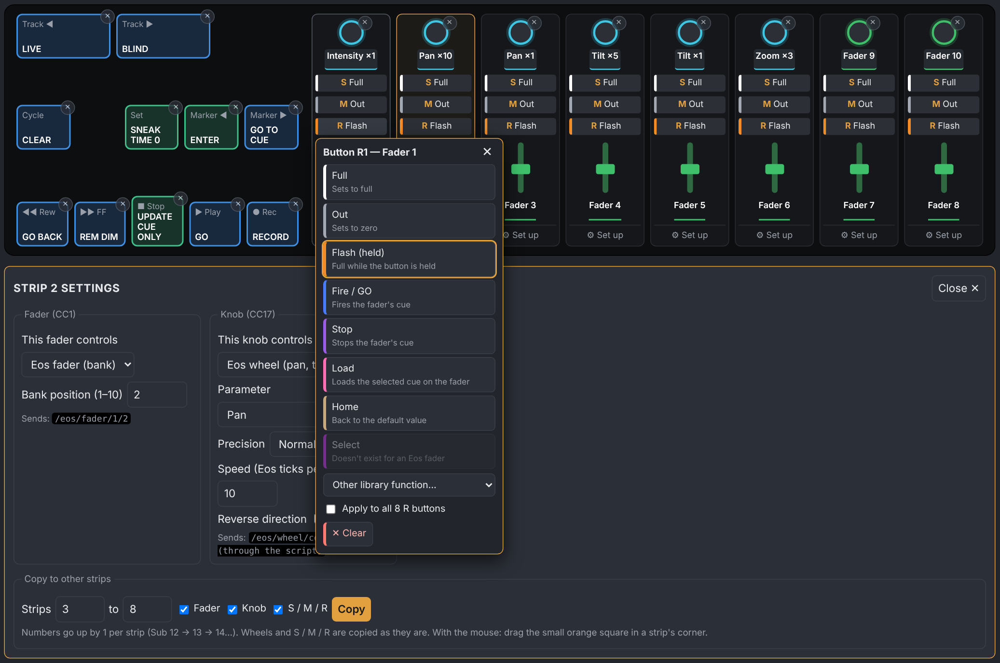
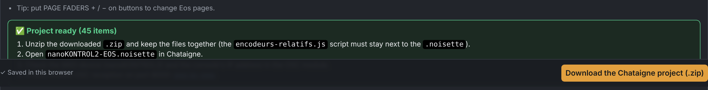
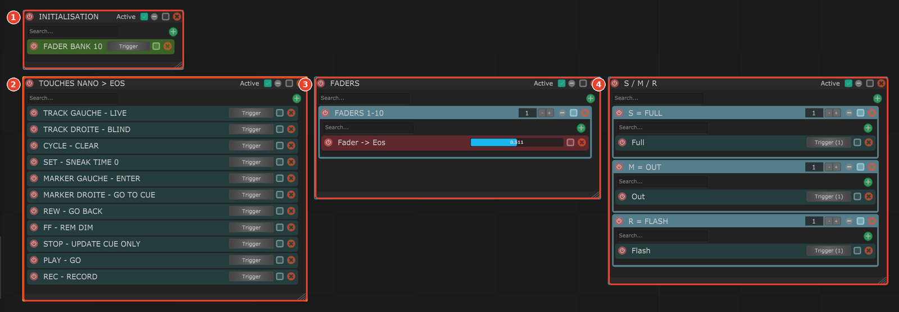
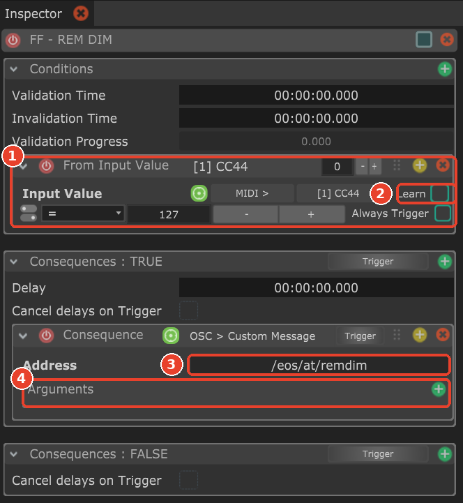
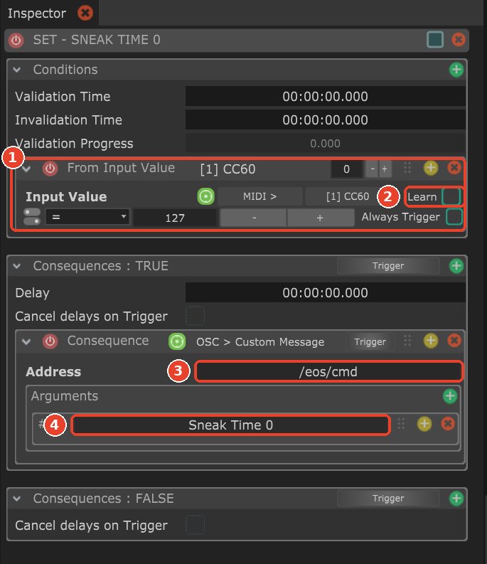
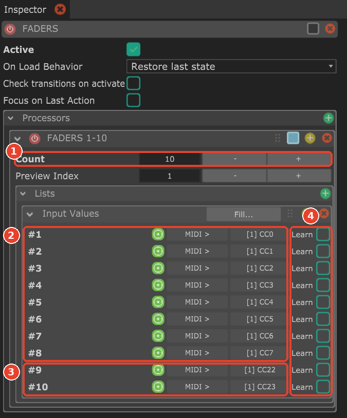

# Korg nanoKONTROL2 → ETC Eos

🇫🇷 [Version française](README.md)

Turns a **Korg nanoKONTROL2** into a **fader wing** (MIDI controller) for **ETC Eos / ETCnomad**: 10 faders, playback keys, command line and knobs as wheels (pan, tilt, zoom, intensity).

| File | Purpose |
|---|---|
| `nanoKONTROL2-EOS.noisette` | Ready-to-use [Chataigne](https://github.com/benkuper/Chataigne) project (mapping above) |
| `encodeurs-relatifs.js` | Script for knobs 1–6 as wheels, keep it next to the `.noisette` |

The configurator is available in English and French (🌐 menu at the top right). The Chataigne project keeps French names (States, Actions) whatever the language; the Chataigne screenshots only carry numbers, explained below each one.

## Contents
1. [Two ways to use it](#two-ways-to-use-it)
2. [Setup](#setup)
   - [Prepare](#prepare)
   - [MIDI module](#midi-module)
   - [OSC module](#osc-module)
   - [Test](#test)
3. [Default mapping](#default-mapping)
4. [The configurator](#the-configurator)
5. [Fader pages](#fader-pages)
6. [Knobs as wheels](#knobs-as-wheels)
7. [The Chataigne project](#the-chataigne-project)
   - [Project layout](#project-layout)
   - [Change a button](#change-a-button)
   - [Change the faders](#change-the-faders)
8. [nanoKONTROL2 CC numbers](#nanokontrol2-cc-numbers)
9. [Troubleshooting](#troubleshooting)

---

## Two ways to use it
| | For | How |
|---|---|---|
| **A. Configurator** (recommended) | You want to choose your functions | [Open the configurator](https://100ders.github.io/eos-chataigne-controllers/?lang=en), set it up, download the `.zip` |
| **B. Ready-made project** | The mapping above suits you | Download `nanoKONTROL2-EOS.noisette` and `encodeurs-relatifs.js` into the same folder |

Then follow the setup.

---

## Setup

### Prepare
1. **Chataigne**: install it from the [download page](https://benjamin.kuperberg.fr/chataigne/en) ([source code](https://github.com/benkuper/Chataigne)). Tested with **1.9.24**.
2. **Eos**: enable OSC reception on port **8000** → [Eos setup](../docs/eos-osc-setup.en.md). OSC feedback (TX) is not needed.
3. **nanoKONTROL2**: plug in the nano. It must be in **CC mode** (factory setting). If it is in DAW mode, the Chataigne Logger shows *Pitch Wheel*: unplug the nano, hold **CYCLE + SET**, plug it back in.
4. Open the `.noisette` in Chataigne.

### MIDI module
In the **Modules** panel, click **MIDI**.

1. **Devices**: select the nano as input. It is called `nanoKONTROL2` on Windows and `nanoKONTROL2 SLIDER/KNOB` on macOS.
2. **Is Connected**: the square turns blue when the nano is connected.
3. **Scripts**: the `encodeurs-relatifs.js` script (knobs as wheels). The project looks for it next to the `.noisette`.
4. **Green dot**: script loaded. If it is red, click **Browse…** in *File Path* and pick `encodeurs-relatifs.js`.
5. **Log Incoming**: shows the CCs received from the nano in the Logger. Useful for checking.

### OSC module
In the **Modules** panel, click **OSC**. The projects in this repo are already set this way.

1. **Local**: ticked when Eos runs on the same computer. Untick it for a networked console.
2. **Remote Host**: the Eos console's IP (`127.0.0.1` on the same computer).
3. **Remote port**: **8000**, same as Eos's *OSC UDP RX Port*.
4. **Log Outgoing**: shows every message sent to Eos in the Logger.

### Test
Select a fixture in Eos, then move a knob. The Chataigne **Logger** (bottom of the window) shows:

1. **Received from the nano**: here CC 17 (knob 2) at value 111.
2. **Sent to Eos**: here `/eos/wheel/coarse/pan` with 10 ticks (knob Pan ×10).

Nothing in 1: MIDI problem (see [MIDI module](#midi-module)). Nothing in 2: project or script problem. Both lines are there but Eos doesn't react: [check reception in Eos](../docs/eos-osc-setup.en.md#check-that-it-works).

---

## Default mapping
| Control | Eos function | OSC message |
|---|---|---|
| Faders 1–8 | Faders 1–8 of the displayed page | `/eos/fader/1/<n>` (0–1) |
| Knobs 7–8 | Faders 9–10 (e.g. Grand Master, house) | `/eos/fader/1/9`, `/10` |
| Knobs 1–6 | Intensity · Pan · Pan fine · Tilt · Tilt fine · Zoom, as wheels | `/eos/wheel/…` (script) |
| S · M · R | Full · Out · Flash of the same strip's fader | `/eos/fader/1/<n>/full`, `/out`, `/fire` |
| Track ◀ · ▶ | Live · Blind | `/eos/key/live`, `/blind` |
| Cycle | Clear | `/eos/key/clear_cmd` |
| Set | Sneak Time 0 (confirm with Enter) | `/eos/cmd` |
| Marker ◀ · ▶ | Enter · Go To Cue | `/eos/cmd`, `/eos/key/go_to_cue` |
| ◀◀ · ▶▶ | Go Back · Rem Dim | `/eos/key/stop`, `/eos/at/remdim` |
| ■ · ▶ · ● | Update Cue Only · GO · Record | `/eos/cmd`, `/eos/key/go_0`, `/eos/key/record` |

---

## The configurator
A web page, nothing to install, also works offline (`docs/index.html`): **[open the configurator](https://100ders.github.io/eos-chataigne-controllers/?lang=en)**, in English or French (🌐 menu at the top right).

1. **Assign buttons**: drag a function from the library (below) onto a nano button, or tap the button to pick one (tablet, phone, keyboard). Tapping a button opens its menu: message sent, **Choose a function…**, **✕ Clear**. Custom functions accept an Eos macro, an OSC address or command-line text.
2. **Choose the wheels**: tapping a knob (the circle at the top of each strip) opens its menu:
   - **Eos wheels**: INTENSITY, PAN, PAN FINE, TILT, TILT FINE, ZOOM;
   - **Other**: Eos fader, sub or channel, set in **⚙ Set up**;
   - **✕ Clear**.

   In the **Settings** box, below the nano, the **Knobs** row has two shortcuts: **Default wheels** (1 Intensity · 2 Pan · 3 Pan fine · 4 Tilt · 5 Tilt fine · 6 Zoom) and **Clear all 8**. To change the order, drag a knob onto another: their settings swap. Speed, precision and direction are set in **⚙ Set up**.
3. **Set up a strip**: tap an **S**, **M** or **R** box for its role, or **⚙ Set up** for the full fader and knob settings.

   

4. **Download the Chataigne project**: a `.zip` with the `.noisette`, the knob script, your configuration (`nanokontrol2-config.json`) and a `README.txt`. Then follow the [setup](#setup).

   

Good to know:
- **Profile** (first row of the **Settings** box): an editable name (e.g. “Festival 2027”), followed by **● modified** when the profile changed since it was created, opened or saved. **New ▾** (Fader Wing profile, Empty profile), **Open…** and **Save (.json)**. The name is also used for the `.json` file and the `.zip`. The profile stays in the browser, and the `.json` is included in every `.zip`.
- **Page layout**: the nano alone in its box; below it, the **Settings** box (fader template, knobs, S / M / R buttons); then the **Library**; at the bottom, the **Good to know** box with the colour legend. The header steps fold away with **▴ Hide steps**, and the Settings box with **▴ Fold**: it then shows a one-line summary.
- **Library**: about fifty functions, in tabs (All, Playback, Entry, Palettes, Editing…), with a search box. When the search finds nothing, it offers to create a custom function with that name. A function already in use shows **✓**, or **×2** when it is on two buttons (duplicates are allowed but flagged). Clicking it selects it and makes the buttons carrying it flash.
- **Bottom bar**: save status, warning count and the **Download the Chataigne project (.zip)** button.
- **Keyboard**: skip links to the nano, the library and the download (first Tab). Each group (nano buttons, strips, library) is a single Tab stop: move inside it with the arrow keys. In the strips, ←/→ changes strip and ↑/↓ goes from the knob to S, M, R then **⚙ Set up**. Enter opens the menu, Delete clears.
- **Phone**: the transport buttons move on top, and the 8 strips scroll sideways (3 visible at a time).
- **Custom functions**: **Custom** tab. To delete one: the **✕** in its corner, or Delete on the keyboard. It is also removed from the buttons carrying it; **Undo** puts everything back.
- **Copy a strip**: in **⚙ Set up**, the **Copy to other strips** row (strips *from… to…*, Fader / Knob / S / M / R checkboxes, **Copy** button). Numbers go up by 1 per strip (Sub 12 → 13 → 14…), capped at 10 for Eos faders; wheels and S / M / R are copied as they are. With the mouse: drag the small orange square in a strip's corner onto other strips.
- **Drag and drop**: while dragging, allowed places get a dashed outline and the others fade out (drop impossible). A function goes onto a transport button or an S / M / R box; a wheel onto another knob (swap); a fader onto another fader: the strips then swap fader and S / M / R.
- **Clear an item**: the **✕** in the corner of a set button or knob, **✕ Clear** in its menu, or the Delete key on the keyboard.
- Clearing, **New**, applying a template or opening a profile can be undone for 8 seconds with **Undo**.
- Errors (red) block the download. Warnings (orange) don't.
- The **Fader template** menu (Fader Wing, Subs, Channels) then **Apply to the 8 faders** only sets the faders and their S / M / R. For Subs and Channels, **First no.** sets the number of fader 1. It **leaves knobs 1 to 6 alone**: the wheels stay in place. For knobs 7 and 8, Fader Wing sets them to Eos faders 9 and 10, Subs and Channels clear them. On an empty nano, the template buttons also place the 6 wheels.

**What a strip can control**
| Fader or knob | Message | Possible S / M / R roles |
|---|---|---|
| Eos fader (bank of 10) | `/eos/fader/1/<n>` | Full, Out, Flash (held), Fire / GO, Stop, Load, Home |
| Sub | `/eos/sub/<n>` | Full, Out, Bump (held), Home |
| Channel | `/eos/chan/<n>/intens` (0–100) | Full, Out, Select (through the command line) |
| Wheel (knobs only) | `/eos/wheel/coarse\|fine/<parameter>` | — |

An S / M / R box can also hold any library function. A role that doesn't exist for the fader type is struck through and skipped on export.

---

## Fader pages
⚠️ **PAGE FADERS + / −** send two messages: one changes the nano's fader page (`/eos/fader/1/page/±1`), the other the page displayed in Eos (`/eos/key/page_up` / `page_down`).

**Limitation**: the Eos display **loops** over the configured fader pages (after the last one it goes back to page 1), while the nano's OSC bank keeps going up. The two drift apart.

- Start on **page 1**.
- Don't go past the **last page configured** in Eos.
- If they drift, go back to page 1 with PAGE FADERS −.

If you don't need the Eos display to follow, use a custom function with only `/eos/fader/1/page/1` (or `-1`).

---

## Knobs as wheels
- Each knob step sends Eos wheel ticks to the **selected fixture**. The **speed** (×n) multiplies them.
- The first move after opening the project is the reference: nothing is sent.
- A knob has limited travel: setting it at **noon** gives the same range both ways.
- Repo project: speed is set in the variables at the top of `encodeurs-relatifs.js` (negative = reversed). With the configurator: **Speed** field and **Reverse direction** box.

---

## The Chataigne project

### Project layout

1. **INITIALISATION**: creates the 10-fader Eos bank on load (`/eos/fader/1/config/10`). If the faders are silent, click **Trigger**.
2. **TOUCHES NANO > EOS** (nano keys > Eos): one Action per button, in the nano's physical order, named **nano button – Eos function** (e.g. `FF - REM DIM`).
3. **FADERS**: one Multiplex, faders 1–8 and knobs 7–8 → Eos faders 1–10.
4. **S / M / R**: three Multiplexes, S = Full, M = Out, R = Flash of the same strip's fader.

The configurator's project has the same States. Only difference: FADERS and S / M / R hold one Mapping or Action per control instead of Multiplexes.

### Change a button
Easiest: rebuild the project with the [configurator](#the-configurator). To edit by hand, click the Action in the State Machine. There are two kinds:

| Eos key (`FF - REM DIM`) | Typed command (`SET - SNEAK TIME 0`) |
|---|---|
|  |  |

1. **Trigger button**: the nano CC, on press (value 127).
2. **Learn**: click, then press another nano button to change it.
3. **Address**:
   - Eos key: the key to "press" (e.g. `/eos/at/remdim`, `/eos/key/live`);
   - typed command: always `/eos/cmd`.

   Full list of addresses and key names: [Eos OSC Dictionary](https://www.etcconnect.com/WebDocs/Controls/EosFamilyOnlineHelp/en/Content/22_Show_Control/08_OSC/OSC_Dictionary.htm) (ETC).
4. **Argument**:
   - Eos key: none;
   - typed command: the text as typed on Eos, `#` = Enter (e.g. `Sneak Time 0`, `Update CueOnly #`). Without `#`, the command waits to be confirmed.

Then rename the Action **without accents**: Chataigne uses names for internal addresses. To add a button, duplicate an Action of the same kind and repeat steps 1 to 4. Don't rename MIDI module values: it breaks links (*Link is broken*).

**Typed command examples** (test them on your show): `Select_Active Effect #`, `Select_Last Intensity Recall_From Cue #`, `Cue Label Noir #`, `Macro 5 #`.

### Change the faders
In the **FADERS** State, click the **FADERS 1-10** Multiplex.

1. **Count**: number of inputs. 10 = 8 faders + 2 knobs.
2. **#1 to #8**: nano faders 1 to 8 (CC0 to CC7) → Eos faders 1 to 8.
3. **#9 and #10**: knobs 7 and 8 (CC22, CC23) → Eos faders 9 and 10.
4. **Learn**: click, then move another nano control to change the input.

Input *n* drives Eos fader *n*: the *Fader -> Eos* Mapping output is `/eos/fader/1/{index}`, with a 0–127 → 0–1 remap. To drive subs, replace that address with `/eos/sub/{index}`, here and in the **S / M / R** Multiplexes.

---

## nanoKONTROL2 CC numbers
In Chataigne, each control appears as `[1] CC<number>` (channel 1). Buttons send **127 on press** and **0 on release**.

| Control | CC |
|---|---|
| Faders 1–8 | 0–7 |
| Knobs 1–8 | 16–23 |
| S 1–8 · M 1–8 · R 1–8 | 32–39 · 48–55 · 64–71 |
| Play · Stop · Rew · FF · Rec | 41 · 42 · 43 · 44 · 45 |
| Cycle · Set | 46 · 60 |
| Track ◀ · ▶ | 58 · 59 |
| Marker ◀ · ▶ | 61 · 62 |

If a number doesn't match (nano reconfigured with Korg Kontrol Editor), use **Learn**.

---

## Troubleshooting
| Symptom | Fix |
|---|---|
| Nothing happens | Check the [MIDI module](#midi-module) (*Is Connected* blue) and the [Eos setup](../docs/eos-osc-setup.en.md) |
| Buttons OK, faders silent | **INITIALISATION** State: click **Trigger** |
| *Pitch Wheel* in the Logger | Nano in DAW mode: hold **CYCLE + SET** while plugging it in |
| Knobs 1–6 silent | Script not loaded (red dot, see [MIDI module](#midi-module)), or no fixture selected |
| Nothing in Eos | Follow [Test](#test), then [check reception in Eos](../docs/eos-osc-setup.en.md#check-that-it-works) |
| Faders and Eos display out of sync | See [Fader pages](#fader-pages) |
