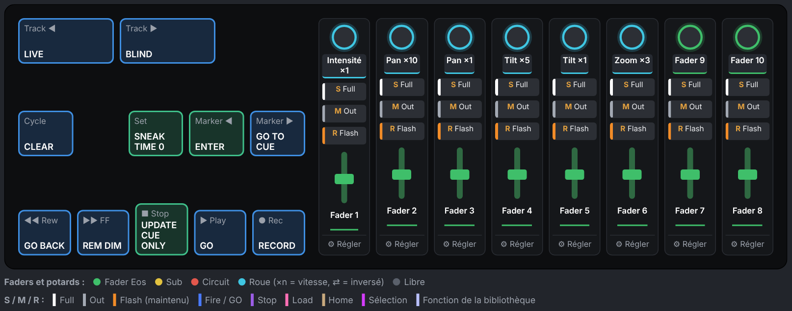
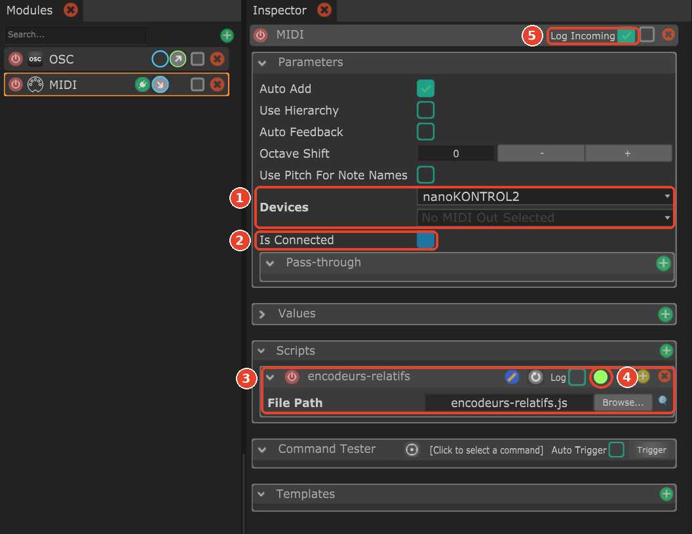
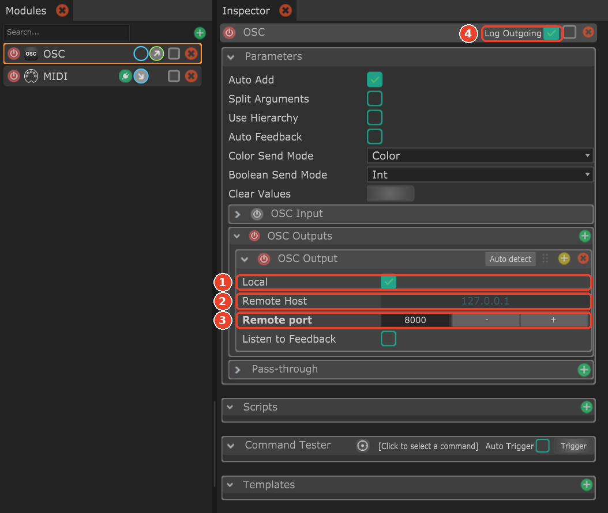
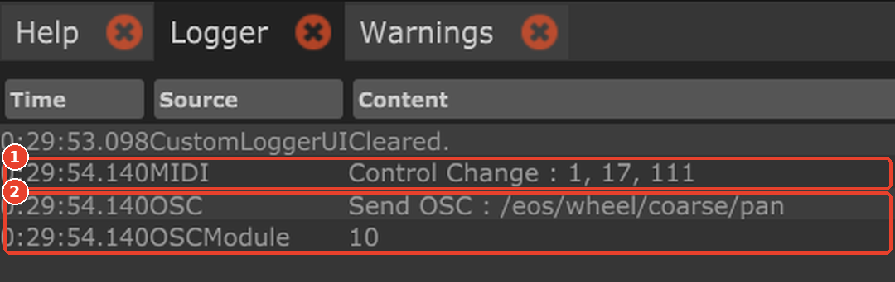
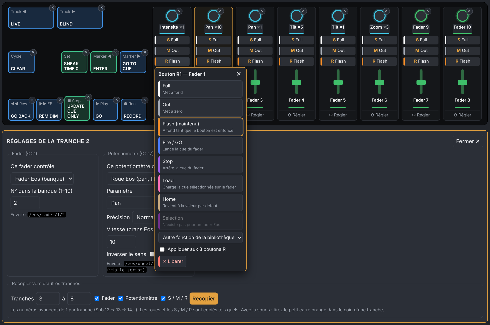
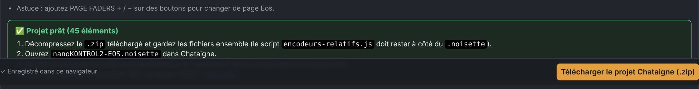
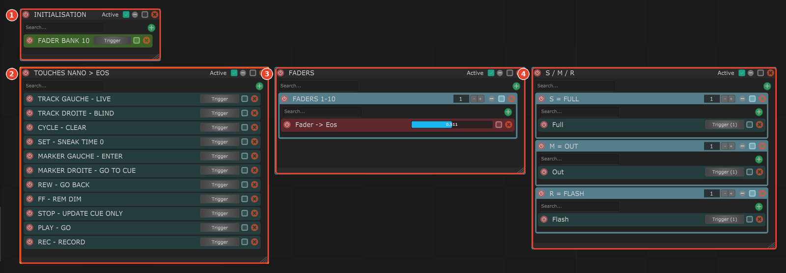
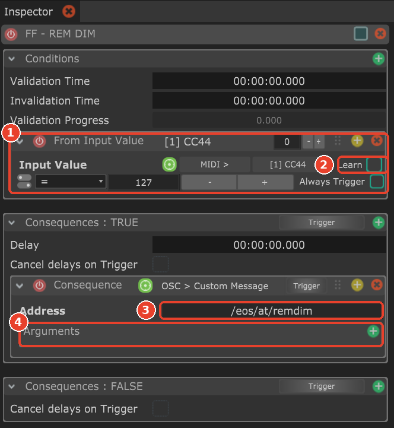
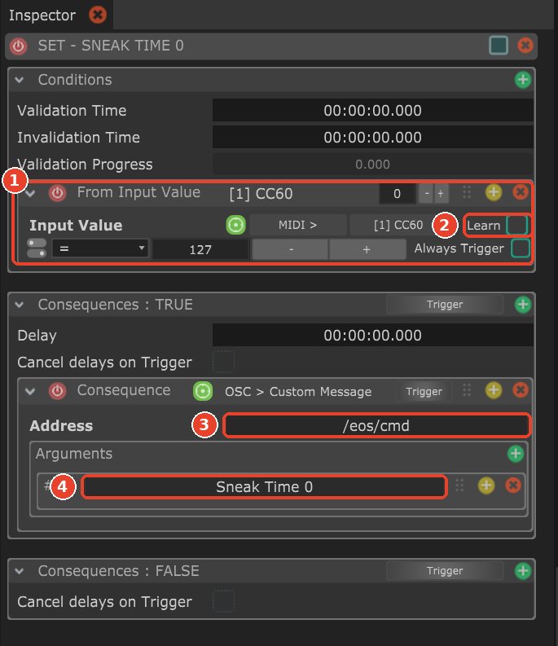
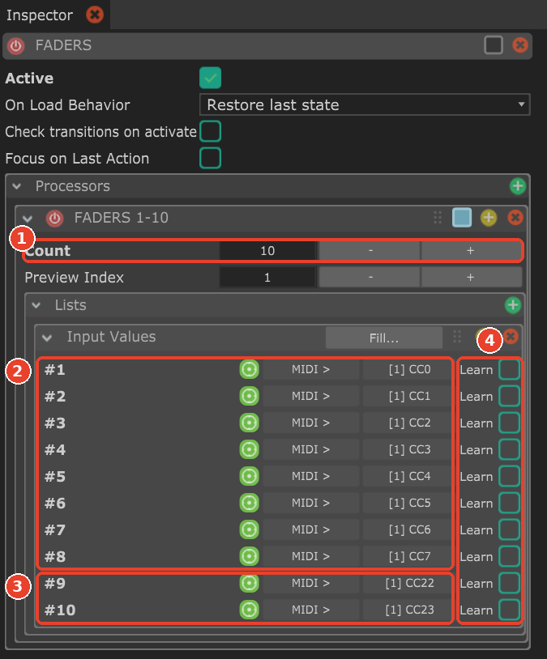

# Korg nanoKONTROL2 → ETC Eos

🇬🇧 [English version](README.en.md)

Transforme un **Korg nanoKONTROL2** en **fader wing** (contrôleur MIDI) pour **ETC Eos / ETCnomad** : 10 faders, touches de restitution, ligne de commande et potentiomètres en roues (pan, tilt, zoom, intensité).

| Fichier | Rôle |
|---|---|
| `nanoKONTROL2-EOS.noisette` | Projet [Chataigne](https://github.com/benkuper/Chataigne) prêt à l'emploi (correspondance ci-dessus) |
| `encodeurs-relatifs.js` | Script des potentiomètres 1–6 en roues, à garder à côté du `.noisette` |

## Sommaire
1. [Deux façons de l'utiliser](#deux-façons-de-lutiliser)
2. [Installation](#installation)
   - [Préparer](#préparer)
   - [Module MIDI](#module-midi)
   - [Module OSC](#module-osc)
   - [Tester](#tester)
3. [Correspondance par défaut](#correspondance-par-défaut)
4. [Le configurateur](#le-configurateur) (et [hors ligne](#hors-ligne))
5. [Pages de faders](#pages-de-faders)
6. [Potentiomètres en roues](#potentiomètres-en-roues)
7. [Le projet Chataigne](#le-projet-chataigne)
   - [Organisation des States](#organisation-des-states)
   - [Modifier un bouton](#modifier-un-bouton)
   - [Modifier les faders](#modifier-les-faders)
8. [Numéros CC du nanoKONTROL2](#numéros-cc-du-nanokontrol2)
9. [Dépannage](#dépannage)

---

## Deux façons de l'utiliser
| | Pour qui | Comment |
|---|---|---|
| **A. Configurateur** (recommandé) | Vous voulez choisir vos fonctions | [Ouvrir le configurateur](https://100ders.github.io/eos-chataigne-controllers/), régler, télécharger le `.zip` |
| **B. Projet prêt** | La correspondance ci-dessus vous convient | Télécharger `nanoKONTROL2-EOS.noisette` et `encodeurs-relatifs.js` dans le même dossier |

Dans les deux cas, suivez ensuite l'installation.

---

## Installation

### Préparer
1. **Chataigne** : l'installer depuis la [page de téléchargement](https://benjamin.kuperberg.fr/chataigne/) ([code source](https://github.com/benkuper/Chataigne)). Testé en **1.9.24**.
2. **Eos** : activer la réception OSC sur le port **8000** → [paramétrage d'Eos](../docs/eos-osc-setup.md). Le retour OSC (TX) n'est pas nécessaire.
3. **nanoKONTROL2** : brancher le nano. Il doit être en **mode CC** (réglage d'usine). S'il est en mode DAW, le Logger de Chataigne affiche des *Pitch Wheel* : débrancher le nano, maintenir **CYCLE + SET**, le rebrancher.
4. Ouvrir le `.noisette` dans Chataigne.

### Module MIDI
Dans le panneau **Modules**, cliquer sur **MIDI**.

1. **Devices** : choisir le nano en entrée. Il s'appelle `nanoKONTROL2` sous Windows et `nanoKONTROL2 SLIDER/KNOB` sous macOS.
2. **Is Connected** : le carré devient bleu quand le nano est connecté.
3. **Scripts** : le script `encodeurs-relatifs.js` (potentiomètres en roues). Le projet le cherche à côté du `.noisette`.
4. **Rond vert** : script chargé. S'il est rouge, cliquer **Browse…** dans *File Path* et choisir `encodeurs-relatifs.js`.
5. **Log Incoming** : affiche dans le Logger les CC reçus du nano. Utile pour vérifier.

### Module OSC
Dans le panneau **Modules**, cliquer sur **OSC**. Les projets du dépôt sont déjà réglés ainsi.

1. **Local** : coché quand Eos tourne sur le même ordinateur. Le décocher pour une console en réseau.
2. **Remote Host** : IP de la console Eos (`127.0.0.1` sur le même ordinateur).
3. **Remote port** : **8000**, comme l'*OSC UDP RX Port* d'Eos.
4. **Log Outgoing** : affiche dans le Logger chaque message envoyé à Eos.

### Tester
Sélectionner un projecteur dans Eos, puis bouger un potentiomètre. Le **Logger** de Chataigne (en bas de la fenêtre) affiche :

1. **Reçu du nano** : ici le CC 17 (potentiomètre 2) à la valeur 111.
2. **Envoyé à Eos** : ici `/eos/wheel/coarse/pan` avec 10 crans (potentiomètre Pan ×10).

Rien en 1 : problème de MIDI (voir [Module MIDI](#module-midi)). Rien en 2 : problème de projet ou de script. Les deux lignes sont là mais Eos ne réagit pas : [vérifier la réception dans Eos](../docs/eos-osc-setup.md#vérifier-que-ça-marche).

---

## Correspondance par défaut
| Contrôle | Fonction Eos | Message OSC |
|---|---|---|
| Faders 1–8 | Faders 1–8 de la page affichée | `/eos/fader/1/<n>` (0–1) |
| Potentiomètres 7–8 | Faders 9–10 (ex. Grand Master, salle) | `/eos/fader/1/9`, `/10` |
| Potentiomètres 1–6 | Intensité · Pan · Pan fine · Tilt · Tilt fine · Zoom, en roues | `/eos/wheel/…` (script) |
| S · M · R | Full · Out · Flash du fader de la même tranche | `/eos/fader/1/<n>/full`, `/out`, `/fire` |
| Track ◀ · ▶ | Live · Blind | `/eos/key/live`, `/blind` |
| Cycle | Clear | `/eos/key/clear_cmd` |
| Set | Sneak Time 0 (valider avec Enter) | `/eos/cmd` |
| Marker ◀ · ▶ | Enter · Go To Cue | `/eos/cmd`, `/eos/key/go_to_cue` |
| ◀◀ · ▶▶ | Go Back · Rem Dim | `/eos/key/stop`, `/eos/at/remdim` |
| ■ · ▶ · ● | Update Cue Only · GO · Record | `/eos/cmd`, `/eos/key/go_0`, `/eos/key/record` |

---

## Le configurateur
Une page web, sans installation, qui fonctionne aussi hors ligne (voir [Hors ligne](#hors-ligne)) : **[ouvrir le configurateur](https://100ders.github.io/eos-chataigne-controllers/)**. Elle existe en français et en anglais (menu 🌐 en haut à droite) ; le projet Chataigne produit est le même dans les deux langues.

1. **Assigner les boutons** : glisser une fonction de la bibliothèque (en bas) sur un bouton du nano, ou toucher le bouton pour la choisir (tablette, téléphone, clavier). Toucher un bouton ouvre son menu : message envoyé, **Choisir une fonction…**, **✕ Libérer**. Les fonctions personnalisées acceptent une macro Eos, une adresse OSC ou un texte de ligne de commande.
2. **Choisir les roues** : toucher un potentiomètre (le cercle en haut de chaque tranche) ouvre son menu :
   - **Roues Eos** : INTENSITÉ, PAN, PAN FINE, TILT, TILT FINE, ZOOM ;
   - **Autre** : fader Eos, sub ou circuit, réglés dans **⚙ Régler** ;
   - **✕ Libérer**.

   Dans la case **Réglages**, sous le nano, la ligne **Potentiomètres** a deux raccourcis : **Roues par défaut** (1 Intensité · 2 Pan · 3 Pan fine · 4 Tilt · 5 Tilt fine · 6 Zoom) et **Libérer les 8**. Pour changer l'ordre, glisser un potentiomètre sur un autre : leurs réglages s'échangent. Vitesse, précision et sens se règlent dans **⚙ Régler**.
3. **Régler une tranche** : toucher une case **S**, **M** ou **R** pour son rôle, ou **⚙ Régler** pour tout le détail du fader et du potentiomètre.

   

4. **Télécharger** le projet : un `.zip` contenant le `.noisette`, le script des potentiomètres, votre configuration (`nanokontrol2-config.json`) et un `LISEZ-MOI.txt`. Suivre ensuite l'[installation](#installation).

   

Bon à savoir :
- **Profil** (première ligne de la case **Réglages**) : un nom modifiable (par exemple « Festival 2027 »), suivi de **● modifié** quand le profil a changé depuis sa création, son ouverture ou son enregistrement. **Nouveau ▾** (Profil Fader Wing, Profil vide), **Ouvrir…** et **Enregistrer (.json)**. Le nom sert aussi pour le fichier `.json` et le `.zip`. Le profil reste dans le navigateur, et le `.json` est inclus dans chaque `.zip`.
- **Organisation de la page** : le nano seul dans sa case ; dessous, la case **Réglages** (modèle des faders, potentiomètres, boutons S / M / R) ; puis la **Bibliothèque** ; en bas, la case **Bon à savoir** avec la légende des couleurs. Les étapes de l'en-tête se replient avec **▴ Masquer les étapes**, et la case Réglages avec **▴ Replier** : elle n'affiche alors qu'un résumé d'une ligne.
- **Bibliothèque** : une cinquantaine de fonctions, en onglets (Toutes, Restitution, Saisie, Palettes, Édition…), avec une recherche. Si la recherche ne trouve rien, elle propose de créer une fonction personnalisée de ce nom. Une fonction déjà utilisée porte **✓**, ou **×2** si elle est sur deux boutons (doublon possible, mais signalé). La cliquer la sélectionne et fait clignoter les boutons qui la portent.
- **Barre du bas** : l'état d'enregistrement, le nombre d'avertissements et le bouton **Télécharger le projet Chataigne (.zip)**.
- **Clavier** : liens d'accès rapide au nano, à la bibliothèque et au téléchargement (premier Tab). Chaque groupe (boutons du nano, tranches, bibliothèque) est un seul arrêt Tab : on s'y déplace avec les flèches. Dans les tranches, ←/→ change de tranche et ↑/↓ passe du potentiomètre à S, M, R puis **⚙ Régler**. Entrée ouvre le menu, Suppr libère.
- **Téléphone** : les boutons de transport passent au-dessus, et les 8 tranches défilent horizontalement (3 visibles à la fois).
- **Fonctions personnalisées** : onglet **Personnalisées**. Pour en supprimer une : la croix **✕** dans son coin, ou Suppr au clavier. Elle est aussi retirée des boutons qui la portent ; **Annuler** remet tout en place.
- **Recopier une tranche** : dans **⚙ Régler**, la ligne **Recopier vers d'autres tranches** (tranches *de… à…*, cases Fader / Potentiomètre / S / M / R, bouton **Recopier**). Les numéros avancent de 1 par tranche (Sub 12 → 13 → 14…), plafonnés à 10 pour les faders Eos ; les roues et les S / M / R sont copiés tels quels. À la souris : tirer le petit carré orange dans le coin d'une tranche vers d'autres tranches.
- **Glisser-déposer** : pendant un glisser, les endroits permis sont entourés en pointillés et les autres s'estompent (dépôt impossible). Une fonction va sur un bouton de transport ou une case S / M / R ; une roue, sur un autre potentiomètre (échange) ; un fader, sur un autre fader : la tranche échange alors fader et S / M / R.
- **Libérer un élément** : la croix **✕** dans le coin d'un bouton ou d'un potentiomètre réglé, **✕ Libérer** dans son menu, ou la touche Suppr au clavier.
- Libérer, **Nouveau**, appliquer un modèle ou ouvrir un profil s'annulent pendant 8 secondes avec **Annuler**.
- Les erreurs (en rouge) bloquent le téléchargement. Les avertissements (en orange) non.
- Le menu **Modèle des faders** (Fader Wing, Subs, Circuits) puis **Appliquer aux 8 faders** ne règle que les faders et leurs S / M / R. Pour Subs et Circuits, **Premier n°** fixe le numéro du fader 1. Il **ne touche pas aux potentiomètres 1 à 6** : les roues restent en place. Pour les potentiomètres 7 et 8, Fader Wing les règle sur les faders Eos 9 et 10, Subs et Circuits les libèrent. Sur un nano vide, les boutons de modèle posent en plus les 6 roues.

**Ce que peut piloter une tranche**
| Fader ou potentiomètre | Message | Rôles possibles pour S / M / R |
|---|---|---|
| Fader Eos (banque de 10) | `/eos/fader/1/<n>` | Full, Out, Flash (maintenu), Fire / GO, Stop, Load, Home |
| Sub | `/eos/sub/<n>` | Full, Out, Bump (maintenu), Home |
| Circuit | `/eos/chan/<n>/intens` (0–100) | Full, Out, Sélection (par la ligne de commande) |
| Roue (potentiomètre seulement) | `/eos/wheel/coarse\|fine/<paramètre>` | — |

Une case S / M / R peut aussi recevoir n'importe quelle fonction de la bibliothèque. Un rôle qui n'existe pas pour le type de fader est barré et ignoré à l'export.

---

### Hors ligne
Le configurateur est un seul fichier HTML, sans dépendance : il fonctionne sans Internet.

1. Télécharger le fichier : lien **⬇ Version hors ligne** en haut de la page, ou `configurateur-nanokontrol2.html` dans la [dernière version publiée](https://github.com/100ders/eos-chataigne-controllers/releases/latest).
2. L'ouvrir d'un double-clic (Chrome, Edge, Firefox ou Safari).

- Tout marche, export du `.zip` compris ; seuls les liens d'aide (mode d'emploi, dictionnaire OSC) demandent Internet.
- Le profil de la version hors ligne est gardé à part de celui du site, et lié à l'emplacement du fichier : après un déplacement, rouvrir son `.json` (**Réglages → Profil → Ouvrir…**).
- La version locale ne se met pas à jour seule : le numéro de version est affiché en bas de page.

## Pages de faders
⚠️ Les fonctions **PAGE FADERS + / −** envoient deux messages : l'un change la page des faders du nano (`/eos/fader/1/page/±1`), l'autre la page affichée dans Eos (`/eos/key/page_up` / `page_down`).

**Limite** : l'affichage d'Eos **boucle** sur les pages de faders configurées (après la dernière, il revient à la page 1), alors que la banque OSC du nano continue de monter. Les deux se décalent.

- Démarrez sur la **page 1**.
- Ne dépassez pas la **dernière page configurée** dans Eos.
- En cas de décalage, revenez à la page 1 avec PAGE FADERS −.

Si l'affichage d'Eos ne vous sert pas, utilisez une fonction personnalisée avec la seule adresse `/eos/fader/1/page/1` (ou `-1`).

---

## Potentiomètres en roues
- Chaque cran de potentiomètre envoie des crans de roue Eos sur le **projecteur sélectionné**. La **vitesse** (×n) multiplie ce nombre.
- Le premier mouvement après l'ouverture du projet sert de référence : rien n'est envoyé.
- Un potentiomètre a une course limitée : le placer à **midi** donne la même amplitude dans les deux sens.
- Projet du dépôt : la vitesse se règle dans les variables en tête de `encodeurs-relatifs.js` (valeur négative = sens inversé). Avec le configurateur : champ **Vitesse** et case **Inverser le sens**.

---

## Le projet Chataigne

### Organisation des States

1. **INITIALISATION** : crée la banque de 10 faders Eos à l'ouverture (`/eos/fader/1/config/10`). Si les faders sont muets, cliquer **Trigger**.
2. **TOUCHES NANO > EOS** : une Action par bouton, dans l'ordre physique du nano, nommée **bouton du nano – fonction Eos** (ex. `FF - REM DIM`).
3. **FADERS** : un Multiplex, faders 1–8 et potentiomètres 7–8 → faders Eos 1–10.
4. **S / M / R** : trois Multiplex, S = Full, M = Out, R = Flash du fader de la même tranche.

Le projet produit par le configurateur a les mêmes States. Seule différence : FADERS et S / M / R y contiennent un Mapping ou une Action par contrôle, au lieu de Multiplex.

### Modifier un bouton
Plus simple : refaire le projet avec le [configurateur](#le-configurateur). Pour modifier à la main, cliquer sur l'Action dans la State Machine. Il en existe deux sortes :

| Touche Eos (`FF - REM DIM`) | Commande tapée (`SET - SNEAK TIME 0`) |
|---|---|
|  |  |

1. **Bouton déclencheur** : le CC du nano, à l'appui (valeur 127).
2. **Learn** : cliquer, puis appuyer sur un autre bouton du nano pour le changer.
3. **Address** :
   - touche Eos : la touche à « appuyer » (ex. `/eos/at/remdim`, `/eos/key/live`) ;
   - commande tapée : toujours `/eos/cmd`.

   Liste complète des adresses et des noms de touches : [dictionnaire OSC d'Eos](https://www.etcconnect.com/WebDocs/Controls/EosFamilyOnlineHelp/en/Content/22_Show_Control/08_OSC/OSC_Dictionary.htm) (ETC, en anglais).
4. **Argument** :
   - touche Eos : aucun ;
   - commande tapée : le texte tel qu'on le tape sur Eos, `#` = Enter (ex. `Sneak Time 0`, `Update CueOnly #`). Sans `#`, la commande attend d'être validée.

Ensuite, renommer l'Action **sans accents** : Chataigne s'en sert pour ses adresses internes. Pour ajouter un bouton, dupliquer une Action de la même sorte et refaire les étapes 1 à 4. Ne renommez pas les valeurs du module MIDI : cela casse les liens (*Link is broken*).

**Exemples de commandes tapées** (à tester sur votre show) : `Select_Active Effect #`, `Select_Last Intensity Recall_From Cue #`, `Cue Label Noir #`, `Macro 5 #`.

### Modifier les faders
Dans le State **FADERS**, cliquer sur le Multiplex **FADERS 1-10**.

1. **Count** : nombre d'entrées. 10 = 8 faders + 2 potentiomètres.
2. **#1 à #8** : faders 1 à 8 du nano (CC0 à CC7) → faders Eos 1 à 8.
3. **#9 et #10** : potentiomètres 7 et 8 (CC22, CC23) → faders Eos 9 et 10.
4. **Learn** : cliquer, puis bouger un autre contrôle du nano pour changer l'entrée.

L'entrée n° *n* pilote le fader Eos *n* : la sortie du Mapping *Fader -> Eos* est `/eos/fader/1/{index}`, avec un remap 0–127 → 0–1. Pour piloter des subs, remplacer cette adresse par `/eos/sub/{index}`, ici et dans les Multiplex **S / M / R**.

---

## Numéros CC du nanoKONTROL2
Dans Chataigne, chaque contrôle apparaît comme `[1] CC<numéro>` (canal 1). Les boutons envoient **127 à l'appui** et **0 au relâchement**.

| Contrôle | CC |
|---|---|
| Faders 1–8 | 0–7 |
| Potentiomètres 1–8 | 16–23 |
| S 1–8 · M 1–8 · R 1–8 | 32–39 · 48–55 · 64–71 |
| Play · Stop · Rew · FF · Rec | 41 · 42 · 43 · 44 · 45 |
| Cycle · Set | 46 · 60 |
| Track ◀ · ▶ | 58 · 59 |
| Marker ◀ · ▶ | 61 · 62 |

Si un numéro ne correspond pas (nano reconfiguré avec Korg Kontrol Editor), utiliser **Learn**.

---

## Dépannage
| Symptôme | Solution |
|---|---|
| Aucune réaction | Vérifier le [module MIDI](#module-midi) (*Is Connected* bleu) et le [paramétrage d'Eos](../docs/eos-osc-setup.md) |
| Boutons OK, faders muets | State **INITIALISATION** : cliquer **Trigger** |
| *Pitch Wheel* dans le Logger | Nano en mode DAW : maintenir **CYCLE + SET** en le branchant |
| Potentiomètres 1–6 muets | Script non chargé (rond rouge, voir [Module MIDI](#module-midi)), ou aucun projecteur sélectionné |
| Rien dans Eos | Suivre [Tester](#tester), puis [vérifier la réception dans Eos](../docs/eos-osc-setup.md#vérifier-que-ça-marche) |
| Faders et affichage Eos décalés | Voir [Pages de faders](#pages-de-faders) |
